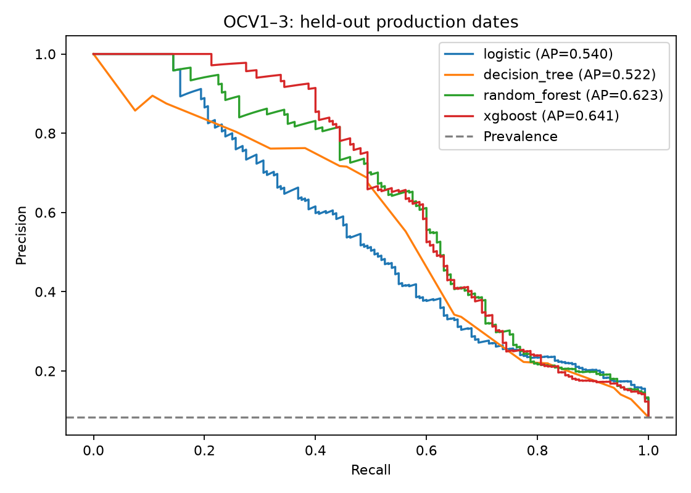
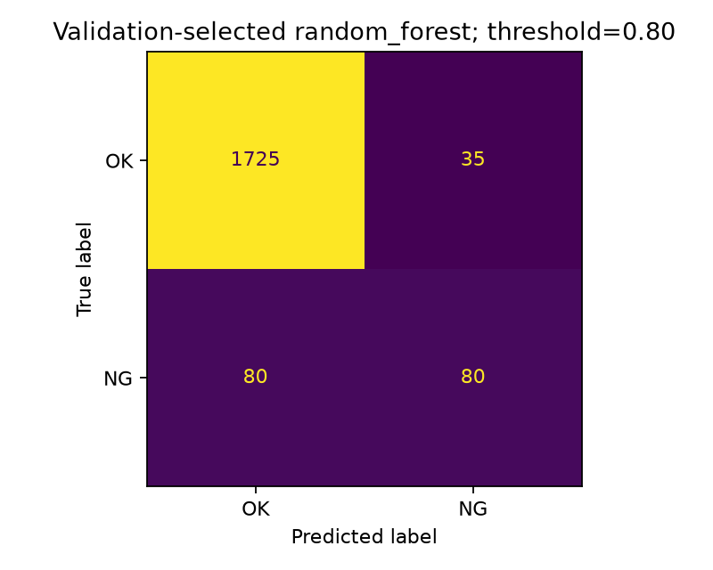
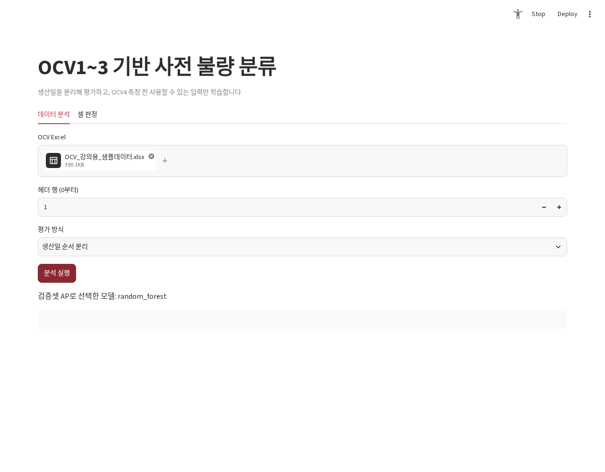

# 배터리 OCV 사전 불량 분류

OCV1~3으로 마지막 OCV4 측정의 저전압 판정을 예측하고, 생산일 분할과 임곗값에 따른 미검출·과검을 비교합니다.

## 문제 정의

최종 측정값으로 정답을 정한 뒤 그 값을 입력에도 넣으면 사전 예측 성능을 평가할 수 없습니다. OCV4를 제외하고 생산일을 분리해 검증했습니다. 실제 공정 적용 여부와 교육용 샘플의 분류 결과를 구분합니다.

## 데이터

제공 ZIP의 `OCV_강의용_샘플데이터.xlsx`를 사용했습니다. 12,000행, NG 1,016개(8.47%), 생산일 9개, 제품 1종이며 제공 필드의 결측치는 없습니다. 파일명에 강의용이라고 표시되어 있고 원래 제조 원자료와 동일한지, 생성·익명화 방식과 재배포 권한은 확인되지 않았습니다. **Excel·회원/학습 parquet·개별 셀 측정값·오류 사례 원문은 추가 공개하지 않습니다.**

초기 조사에서 Excel을 놓쳐 ‘데이터 없음’으로 보고한 오류를 정정했습니다. 강의 노트북의 예전 파일명과 ZIP의 실제 파일명이 다르고, 노트북에는 교육을 위한 빈칸과 TODO가 있어 완성된 실행 결과와 구분했습니다. 사용자는 해당 사내 강의를 직접 진행했다고 확인했습니다.

## 기술 스택과 구조

Python 3.12, pandas, scikit-learn, XGBoost, SciPy, Matplotlib, Streamlit, Ruff, pytest를 사용했습니다.

```text
app.py                         분석 및 같은 모델을 이용한 셀 판정
train_model.py                 CLI 진입점
src/battery_ocv/
  features.py                  OCV1~3 파생변수·라벨 검증
  experiment.py                분할·모델 비교·임곗값·평가·그래프
tests/test_ocv.py
results/temporal/              생산일 분할의 집계 결과
results/random/                무작위 분할 민감도 결과
docs/validation.md
```

기존 `ocv__`와 `ml_streamlit`이 같은 OCV 문제를 다뤄 새 저장소를 늘리지 않았습니다. 기존 앱과 모델 파일은 Git 이력과 별도 원본 사본으로 보존했습니다. 저장소에 남아 있는 과거 `ocv_model.pkl`은 학습 코드·데이터 provenance가 불완전해 새 앱에서 자동 로드하지 않습니다. 새 앱은 업로드 자료로 실행한 실험의 선택 모델을 사용합니다.

## 분석 및 개발 과정

1. OK/NG 라벨을 명시적으로 확인하고 알 수 없는 라벨을 OK로 처리하지 않도록 했습니다.
2. OCV1~3, 전압 차분 2개, 차분의 변화, 표준편차를 사용했습니다. 측정 시간 간격과 단위를 확인하지 못해 물리적 변화율·가속도라고 부르지 않습니다.
3. 생산일 5/2/2개를 학습/검증/평가로 분리했습니다. 각각 7,200/2,880/1,920행입니다. 셀·로트 ID가 주어지면 그룹 겹침도 검사합니다.
4. 결측 대체·표준화·클래스 가중치는 학습 자료로만 계산합니다. 로지스틱 회귀, 결정나무, 랜덤포레스트, XGBoost를 같은 분할에서 비교했습니다.
5. 모델은 검증셋 average precision(AP), 임곗값은 검증셋 F1으로 선택합니다. 평가셋을 보고 다시 모델을 고르지 않았습니다.

## 주요 결과

아래는 제공된 강의용 샘플의 생산일 평가 결과입니다. 각 모델의 임곗값은 검증셋에서 선택했습니다.

| 모델 | Precision | Recall | F1 | AP |
|---|---:|---:|---:|---:|
| 로지스틱 회귀 | 0.491 | 0.513 | 0.502 | 0.539 |
| 결정나무 | 0.675 | 0.494 | 0.570 | 0.522 |
| 랜덤포레스트 | 0.696 | 0.500 | 0.582 | 0.623 |
| XGBoost | 0.624 | 0.581 | 0.602 | 0.641 |

검증셋 기준 선택 모델은 랜덤포레스트입니다. XGBoost의 평가 AP가 더 높다는 이유로 평가 후 선택을 바꾸지 않았습니다. 선택 모델의 임곗값 0.80에서 TN=1,725, FP=35, FN=80, TP=80입니다.

**Recall 0.98·Precision 0.94는 이 실험에서 재현되지 않았으며 검증된 성과로 표시하지 않습니다.** 기존 앱 방식으로 OCV4까지 넣으면 이 샘플에서는 Precision/Recall이 모두 1.0이지만, 라벨이 OCV4<35와 12,000행 모두 일치하므로 사전 예측 결과로 사용할 수 없습니다.





임곗값 0.50→0.80에서 같은 랜덤포레스트의 Precision은 0.305→0.696, Recall은 0.725→0.500으로 바뀌었습니다. FP는 264→35로 줄고 FN은 44→80으로 늘었습니다. 모든 지표가 함께 좋아졌다고 해석하지 않습니다. 고객 비용이나 허용 미검출률을 모르는 상태에서 F1 기준을 운영 최적점으로 주장하지 않습니다.

## 실행

```bash
python -m venv .venv
source .venv/bin/activate
pip install -e .
python train_model.py /path/to/private/sample.xlsx --header 1 --output results/local
# 같은 함수의 무작위 분할 민감도 검사
ocv-experiment /path/to/private/sample.xlsx --output results/random_local --split random
streamlit run app.py
```

실제 셀·로트 그룹을 보유했다면 `--group-column`으로 날짜 간 그룹 중복을 검사하거나 `--split group --group-column LOT_ID`로 그룹 분할합니다. 제품명 하나만 있는 자료를 임의로 다수 독립 그룹으로 취급하지 않습니다.

`metrics.json`, PR 곡선, 혼동행렬, 검증 임곗값 표가 생성됩니다. `private/`에는 개별 오류 사례와 분할 인덱스가 생성되며 Git에서 제외됩니다. 모델 NG 점수는 확률 보정을 수행한 값이 아닙니다.

```bash
pip install -r requirements-dev.txt
pytest -q
ruff check app.py train_model.py src tests
```

## 검증과 한계

8개 테스트와 실제 Excel의 두 분할·4모델 실행을 확인했습니다. 브라우저에서도 실제 파일 업로드·모델 학습·셀 판정을 실행했습니다. 시간 분리, 그룹 겹침, OCV4 유입 차단, 학습 내 결측 처리, 라벨 검사와 지표 분모를 테스트합니다. [검증 기록](docs/validation.md)에 기존 앱과의 차이, 오류 사례, 6σ/5σ 해석과 재현 범위를 기록했습니다.

생산일 9개·제품 1종으로 장기간 공정 변화나 다른 제품에 일반화할 수 없습니다. 셀 ID가 없어 반복 측정 누수를 완전히 배제하지 못했습니다. 원래 제조 데이터와 당시 분할·모델·임곗값이 없으므로 이 결과로 과거 성과를 반증하거나 재현했다고 단정하지 않습니다. 독립 로트·미사용 생산일, 측정 간격·단위, 고객 판정 기준과 재작업 비용의 확인이 필요합니다.


